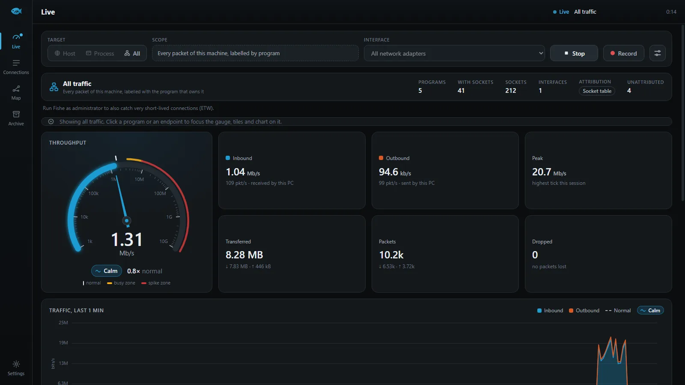
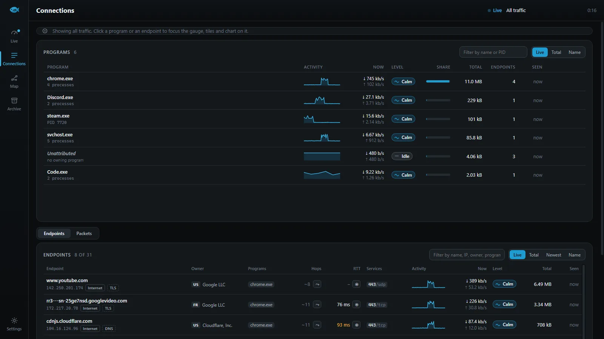

# Fishe

A real-time network traffic monitor for Windows. Fishe measures the traffic
of a remote host, of one program, or of the whole machine, shows when it is
busier than usual, and tells you where it goes and how well the connections
behave. It observes only: it never blocks or changes anything on the
network.



## Features

- **Three targets.** A remote host (IP or name), one program (all its
  processes, or a single PID), or all traffic of the PC labelled by program.
- **A gauge that knows what is normal.** Fishe learns the usual level of
  the target and classifies the current traffic as idle, calm, busy or
  spike relative to it, on a dial and on a rolling chart.
- **Per-program attribution.** Each packet is matched to the program that
  owns its socket. No administrator rights needed; running elevated makes
  it exact for very short-lived connections.
- **Named endpoints.** Remote addresses are named from the traffic itself
  (TLS server names, DNS answers) and from reverse DNS, with the owning
  organisation and country from an offline database.
- **Connection quality.** Round-trip time, jitter and retransmissions
  measured passively from TCP, per endpoint and for the session, plus an
  on-demand continuous ping.
- **Network map.** Traceroutes drawn as one graph of shared routers from
  this PC to every endpoint.
- **LAN scan.** The devices on the local network, with their maker and the
  services they offer.
- **Recordings.** A session can be recorded, replayed later and exported to
  CSV or JSON, optionally with a pcapng file of the packet headers.
- **An interface for AI agents.** A local Model Context Protocol (MCP)
  server lets an agent read the measurements and, if you allow it, start
  monitoring, record or run probes.

## Requirements

- Windows 10 or 11, 64-bit.
- [Npcap](https://npcap.com), installed with its default options. It is not
  bundled; Fishe shows how to install it when it is missing.

## Install

Download the installer of the latest version from the **Releases** page and
run it. The installers are not code-signed, so Windows SmartScreen asks for
confirmation on first run.

## Usage

1. On the **Live** page, choose a target: **Host**, **Process** or **All**.
2. For a host, type an address or name. For a process, pick a running
   program. The network interface is chosen automatically.
3. Press **Start**. The gauge, the chart and the figures update four times
   a second.
4. Press **Record** to save the session to the archive; press it again to
   stop.

The pages, each one key away:

| Key | Page | Shows |
|---|---|---|
| 1 | Live | Gauge, rates, chart, connection quality, the busiest programs or endpoints, protocols and ports |
| 2 | Connections | Every program and endpoint of the session, or the live packet list |
| 3 | Map | The LAN scan and the map of routes to the endpoints |
| 4 | Archive | Saved recordings: replay, rename, export, delete |
| 5 | Settings | Sensitivity, units, owner database, agents, diagnostics |

Clicking a program or an endpoint focuses the gauge and the chart on it.



### Agents

The MCP server is off by default. Enable it in **Settings**, under **Agents (MCP)**,
choose an access level (read only, control, or network probes) and copy the
configuration shown for your client. It listens on this PC only and requires
a token. See [docs/mcp.md](docs/mcp.md).

## Privacy

- Only packet headers are read (the first 192 bytes), plus DNS answers and
  the unencrypted TLS server name, to name endpoints. Encrypted content is
  never examined.
- No traffic is stored unless you record, and recordings stay on your PC.
- Nothing is sent anywhere by default. Two options send data when you turn
  them on: reverse DNS (queries to your DNS server) and the online owner
  lookup (public addresses to ipinfo.io). The owner database is downloaded
  from db-ip.com only when you ask.
- Traceroute, ping and the LAN scan send packets, and only when you start
  them. Use the LAN scan on networks you own or administer.

## Build from source

Requires Rust (stable, MSVC), Node.js 22.17 or later, and Npcap.

```powershell
powershell -ExecutionPolicy Bypass -File scripts/setup-npcap-sdk.ps1
npm install
npm run tauri dev
```

`npm run tauri build` produces the installers. See
[docs/development.md](docs/development.md) for tests, the workspace layout
and the release process.

## Documentation

| Document | Contents |
|---|---|
| [architecture.md](docs/architecture.md) | Components, threads, data flow, design choices |
| [capture-engine.md](docs/capture-engine.md) | Npcap loading, filters, header parsing, what is counted |
| [busyness-detection.md](docs/busyness-detection.md) | The baseline and the idle / calm / busy / spike levels |
| [process-mode.md](docs/process-mode.md) | Attributing packets to programs; accuracy and limits |
| [all-traffic.md](docs/all-traffic.md) | All-traffic mode, the programs table, the packet list |
| [endpoints.md](docs/endpoints.md) | Endpoint naming, address types, focus |
| [owners.md](docs/owners.md) | Owner and country of an address |
| [connection-quality.md](docs/connection-quality.md) | Round-trip time, jitter, retransmissions, ping |
| [network-map.md](docs/network-map.md) | Traceroute and the map layout |
| [lan-mapping.md](docs/lan-mapping.md) | The LAN scan |
| [archive.md](docs/archive.md) | Recordings, storage, exports |
| [mcp.md](docs/mcp.md) | The MCP server: setup, tools, security |
| [ipc-api.md](docs/ipc-api.md) | Commands, events and types between the window and the backend |
| [frontend.md](docs/frontend.md) | Structure of the Svelte interface |
| [development.md](docs/development.md) | Setup, tests, building, releases |

## Licence

MIT. See [LICENSE](LICENSE).

Fishe uses [Npcap](https://npcap.com) for packet capture and the
[DB-IP Lite](https://db-ip.com) database for owner and country data
(CC BY 4.0).
